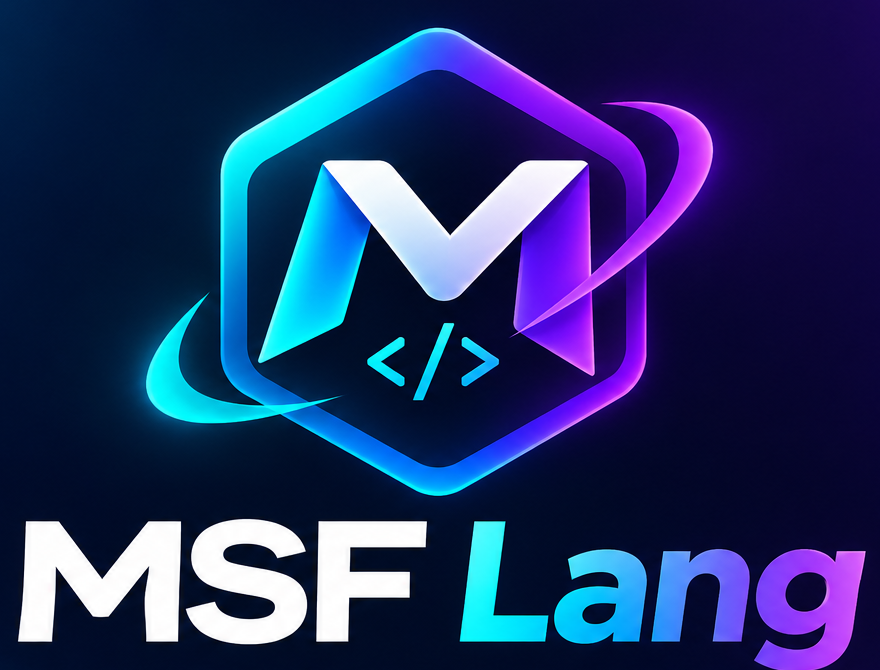

<div align="center">



[Official brand guidelines](branding/BRAND-GUIDELINES.md)

# MSF Lang

**A small, precise, and testable programming language — designed and engineered by Mustafa Software Factory.**

[](https://dotnet.microsoft.com/)
[](src/)
[](docs/en/SPEC-v0.1.md)
[](#project-status)
[](LICENSE)

*Deterministic semantics · clear diagnostics · implementation-first specification*

[User Guide](docs/guide/README.md) · [Specification](docs/en/SPEC-v0.1.md) · [Implementation Plan](docs/en/IMPLEMENTATION-PLAN.md) · [Decisions](docs/DECISIONS.md) · [العربية](#العربية)

</div>

---

## Overview

**MSF Lang** (`.msf`) is a small, general-purpose, dynamically typed programming language built with a focus on:

- **Clarity** — explicit syntax, no implicit conversions, no truthiness
- **Precision** — stable diagnostic codes, 1-based Unicode-scalar locations, source excerpts
- **Testability** — specification-driven development with traceable milestones and recorded evidence
- **Craft** — a hand-written lexer, recursive-descent parser, semantic resolver, and tree-walk interpreter in C#/.NET

This repository contains the language specification, architecture decisions, grammar, branding concepts, and the evolving reference implementation.

> **Current state:** active development. Core pipeline (source/diagnostics → lexer → parser → resolver → interpreter) is implemented for key v0.1 features, and `msf run` executes real `.msf` programs. The CLI/REPL contract, full conformance suite, and release hardening are in progress.

---

## Quick Start

### Prerequisites
- [.NET SDK 10.0+](https://dotnet.microsoft.com/download) (see [`global.json`](global.json))

### Build
```powershell
dotnet restore MSFLang.slnx
dotnet build MSFLang.slnx -c Release -warnaserror
```

### Run a program
```powershell
dotnet run --project src/MsfLang.Cli -c Release -- run examples/hello.msf
```

**Output**
```text
Hello, MSF!
```

### CLI
```text
msf run <path>       Execute a .msf program
msf repl             Interactive/piped REPL
msf --help | -h      Show usage
msf --version | -v   Print version
```

---

## Example

```msf
fn factorial(n) {
    if (n <= 1) {
        return 1;
    }
    return n * factorial(n - 1);
}

fn fibonacci(n) {
    if (n < 2) {
        return n;
    }
    return fibonacci(n - 1) + fibonacci(n - 2);
}

print(factorial(10));
print(fibonacci(10));
```

```text
3628800
55
```

More examples: [`examples/`](examples/)

---

## Language at a Glance (v0.1)

| Area | v0.1 Design |
|---|---|
| Values | `number` (finite IEEE-754 double), `string`, `boolean`, `nil` |
| Bindings | `let` (immutable), `var` (mutable), block scope |
| Control flow | `if` / `else if` / `else` |
| Functions | Top-level named functions, exact arity, direct recursion |
| Operators | Arithmetic, comparison, equality, short-circuit `and`/`or`, `not` |
| Output | Built-in `print(...)` |
| Diagnostics | Stable codes (`E1xxx`–`E5xxx`), line/column, excerpt, hint |
| Out of scope (v0.1) | Loops, collections, closures, modules/imports, I/O beyond `print`, stdlib |

See the normative specification: [English](docs/en/SPEC-v0.1.md) · [العربية](docs/ar/SPEC-v0.1.md)

---

## Architecture

```text
Source (.msf)
   │
   â–¼
SourceText / line map
   │
   â–¼
Lexer        → tokens            (E1xxx)
   │
   â–¼
Parser       → AST               (E2xxx)
   │
   â–¼
Resolver     → bindings/IDs      (E3xxx)
   │
   â–¼
Interpreter  → execution/output  (E4xxx)
```

- **Core engine:** [`src/MsfLang.Core`](src/MsfLang.Core)
- **CLI:** [`src/MsfLang.Cli`](src/MsfLang.Cli)
- **Grammar:** [`grammar/msf-v0.1.ebnf`](grammar/msf-v0.1.ebnf)
- **Tests:** [`tests/`](tests/)

---

## Project Status

| Milestone | Scope | Status |
|---|---|---|
| M0 | Specification, plan, decisions, grammar, brand concepts | ✅ Gate A approved |
| M1 | Solution scaffold & build | ✅ Complete |
| M2 | Source text & diagnostics | ✅ Complete |
| M3 | Lexer | ✅ Complete |
| M4 | Parser & AST | ✅ Complete |
| M5 | Resolver & semantic checks | ✅ Complete |
| M6 | Interpreter & runtime | 🚧 Core implemented (values, operators, control flow, functions/recursion, `print`, depth limit) + examples/tests green; edge-case hardening ongoing |
| M7 | CLI & REPL contract | 🚧 `run/help/version/repl` implemented; process-level tests added; full spec-contract edge cases ongoing |
| M8 | Conformance suite & examples | 🚧 Harness + **63** conformance cases passing (60+ target reached; matrix/hardening ongoing) |
| M9 | Hardening & release candidate | ⏳ Planned |

Execution evidence is recorded in [`docs/TEST-EVIDENCE.md`](docs/TEST-EVIDENCE.md).

---

## Repository Structure

```text
.
├── src/
│   ├── MsfLang.Core/        # Language engine (source, diagnostics, lex/parse/resolve/runtime/repl)
│   └── MsfLang.Cli/         # msf command-line interface
├── tests/
│   ├── conformance/         # .msf programs + .expected.json fixtures
│   ├── MsfLang.*.Tests/     # Unit, CLI, and conformance test projects
│   └── MsfLang.TestSupport/
├── examples/                # Runnable .msf programs
├── benchmarks/              # Benchmark programs, runner, and results
├── docs/                    # Specs, plans, guides, roadmap, decisions, evidence (EN/AR)
├── grammar/                 # Machine-readable EBNF
├── branding/                # Brand concepts and review materials
├── MSFLang.slnx
├── Directory.Build.props
└── global.json
```

---

## Documentation

### User Guide (How to use MSF Lang)
- [Guide Index](docs/guide/README.md)
- [Getting Started](docs/guide/getting-started.md)
- [Syntax & Language Basics](docs/guide/syntax.md)
- [CLI Reference](docs/guide/cli.md)
- [Diagnostics & Errors](docs/guide/diagnostics.md)
- [Examples](docs/guide/examples.md)
- [Benchmarks](docs/guide/benchmarks.md)

### Vision & Direction
- [Problem-Solving Direction](docs/PROBLEM-SOLVING.md)
- [Roadmap](docs/ROADMAP.md)

### Reference & Project Docs
- [Language Specification (EN)](docs/en/SPEC-v0.1.md)
- [مواصفة اللغة (AR)](docs/ar/SPEC-v0.1.md)
- [Implementation & Test Plan (EN)](docs/en/IMPLEMENTATION-PLAN.md)
- [خطة التنفيذ والاختبارات (AR)](docs/ar/IMPLEMENTATION-PLAN.md)
- [Architecture Decisions](docs/DECISIONS.md)
- [Test Evidence Log](docs/TEST-EVIDENCE.md)
- [Brand Concepts](branding/CONCEPTS.md)

---

## العربية

**MSF Lang** لغة برمجة صغيرة ودقيقة بامتداد `.msf`، طورتها **Mustafa Software Factory** مع تركيز على الوضوح، التشخيص الدقيق، والاختبارية.

- المواصفة والخطة والقرارات متاحة بالعربية والإنجليزية داخل [`docs/`](docs/)
- الحالة الحالية: تنفيذ نواة اللغة (المعجم، المحلل، الدلالات، المفسر) وتشغيل البرامج عبر `msf run` و`msf repl` (أساسي)، مع استمرار العمل على اكتمال العقد، وحزمة المطابقة، والتقسية
- الكلمات المحجوزة إنجليزية في v0.1، مع دعم كامل للنصوص والتعليقات والمخرجات العربية

---

## Contributing

Contributions, issues, and design discussions are welcome. If you propose a language change, please align it with the [specification](docs/en/SPEC-v0.1.md), [decisions log](docs/DECISIONS.md), and implementation plan.

## License

Distributed under the [MIT License](LICENSE).

---

<div align="center">

**MSF Lang** · Built with precision by Mustafa Software Factory

</div>
